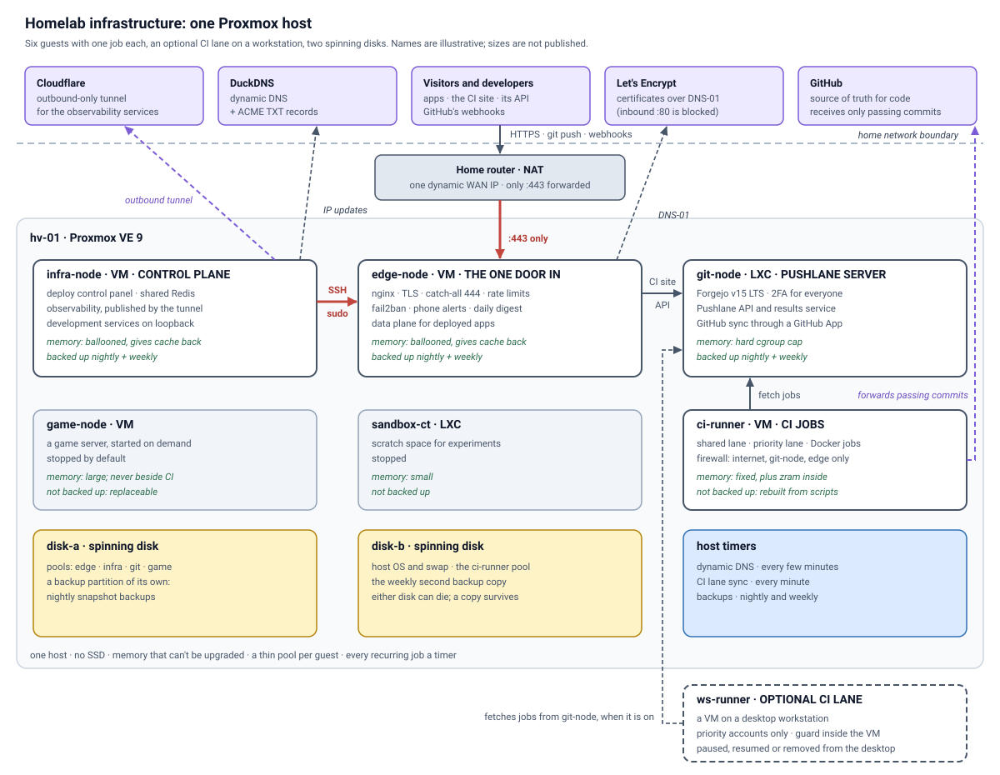

# proxmox-homelab

**The infrastructure behind a one-box homelab, documented end to end.** A single Proxmox VE host runs an
internet-facing edge proxy, a private control plane that deploys web apps, a self-hosted Git server with a CI
system in front of GitHub, a sandboxed CI runner and a couple of on-demand guests. A desktop workstation can lend
the CI system extra capacity when it is switched on.

This repository explains how those pieces fit together and why they are shaped the way they are: the host and
its storage, every guest, the network path, the security layers, backups, day-to-day operations, and the
failures the setup has already survived. It doubles as my own operating manual and as a set of write-ups for
anyone curious about running real services on one machine at home.

<p>


</p>

> **About this repository.** It describes a real, running homelab, but every hostname, address, domain and
> account in it is a placeholder, and hardware sizes, guest sizes and exact limits are deliberately left out.
> The structure, the mechanisms and the failure stories are real. See [Sanitisation](#sanitisation).

The software that runs on top of this infrastructure (the deploy control panel and the Pushlane CI system)
lives in its own repository: **[Homelab-Control-Plane](https://github.com/tobioj/Homelab-Control-Plane)**.

---

## Contents

- [At a glance](#at-a-glance)
- [Topology](#topology)
- [The guests](#the-guests)
- [Design principles](#design-principles)
- [Edge cases it already handles](#edge-cases-it-already-handles)
- [Reading guide](#reading-guide)
- [Repository map](#repository-map)
- [Sanitisation](#sanitisation)

---

## At a glance

| | |
| --- | --- |
| **Hypervisor** | One Proxmox VE 9 host, `hv-01`: a single machine with two spinning disks, no SSD, and memory that can't be upgraded |
| **Guests** | Four KVM virtual machines and two LXC containers, each with its own storage pool, plus an optional CI VM on a workstation |
| **Ways in** | One forwarded port (`:443`), terminated by nginx on `edge-node`, and one outbound-only tunnel that publishes the observability services |
| **TLS** | Let's Encrypt over DNS-01 (the ISP blocks inbound `:80`), with dynamic DNS kept current by a timer |
| **Workloads** | An app-deployment control plane, Git hosting, CI with priority and shared job lanes, observability, development services, an on-demand game server |
| **Security** | Rate limits, a catch-all `444` vhost, fail2ban jails with escalating bans, phone alerts and a daily digest, 2FA on every account |
| **CI isolation** | Jobs run in unprivileged containers on machines that can reach the internet and the Git server, and nothing else on the LAN |
| **Backups** | Nightly snapshot backups to one disk, a weekly second copy on the other |
| **Operations** | One admin CLI, a timer for every recurring job, and configuration changes that never kill a running CI job |

---

## Topology



Three rules shape the whole picture:

1. **One door in for public traffic.** Only `edge-node` is reachable through the router, and only on `:443`.
   Everything public (apps, the CI site, its API, GitHub's webhooks) passes one proxy, where TLS, rate limits
   and bans live.
2. **Observability goes out, not in.** Dashboards, error tracking, log ingest and push alerts are published
   through an outbound-only Cloudflare Tunnel from `infra-node`, so no second port is ever opened on the router.
3. **CI runners are treated as hostile.** They run other people's code, so they may talk to the internet, to
   `git-node` and to the edge proxy, and to nothing else on the LAN.

The network path in detail is in [docs/NETWORK.md](docs/NETWORK.md).

---

## The guests

| Guest | Type | Role | Memory policy | Exposure | Backed up |
| --- | --- | --- | --- | --- | --- |
| `edge-node` | VM | Public nginx, TLS, fail2ban; the data plane for deployed apps | Ballooned, gives cache back | `:443` via the router | Nightly + weekly copy |
| `infra-node` | VM | Deploy control panel, shared Redis, observability, development services | Ballooned, gives cache back | LAN; observability via the tunnel | Nightly + weekly copy |
| `git-node` | LXC | Forgejo, the Pushlane API and results service, GitHub sync | Hard cgroup cap | Through `edge-node` only | Nightly + weekly copy |
| `ci-runner` | VM | Docker CI runner: the shared lane and the priority lane | Fixed, never ballooned | None (outbound only) | No: rebuilt from scripts |
| `game-node` | VM | Game server, started on demand | Large; only when CI is stopped | Only while it runs | No: replaceable |
| `sandbox-ct` | LXC | Scratch container for experiments | Small | LAN only | No |
| `ws-runner` | VM, off-host | Optional priority CI lane on a desktop workstation | The workstation's own | None (outbound only) | No: rebuilt from scripts |

What runs inside each one, what it may reach and how it is managed: [docs/GUESTS.md](docs/GUESTS.md). How the
disks and memory are shared out: [docs/HOST.md](docs/HOST.md).

---

## Design principles

| Principle | What it means here |
| --- | --- |
| **One door in** | A single forwarded port, a single proxy, a single place to rate-limit, log and ban. |
| **Go out, don't let in** | Anything else that must be reachable from outside leaves through an outbound tunnel instead of a new port. |
| **Untrusted code gets its own box** | CI jobs run in unprivileged containers on dedicated VMs with egress firewalls. |
| **Nothing important lives only on one disk** | Nightly backups land on one disk, a weekly second copy on the other. |
| **The disposable stays disposable** | The runners are rebuilt from scripts in minutes, so they are deliberately not backed up. |
| **Every recurring job is a timer** | DNS updates, account-to-lane sync, cleanup and backups are all systemd or Proxmox schedules, never a hand-run step. |
| **Changes never kill work in flight** | Reconfiguring a CI lane waits for its running jobs to finish. |
| **Measure the real bottleneck** | On spinning disks, I/O, not CPU, sets how many CI jobs can run at once. |
| **Borrow before you buy** | Extra CI capacity comes from a workstation that is often idle, contained in a VM that is easy to pause or remove. |

---

## Edge cases it already handles

Each one is a real failure that changed the design. Full write-ups, as symptom, cause, fix and lesson, are in
[docs/EDGE-CASES.md](docs/EDGE-CASES.md).

| Situation | How it is handled |
| --- | --- |
| A burst of concurrent CI jobs saturated the disk and Docker stopped answering | Concurrency lowered in measured steps, test databases moved to tmpfs, a workstation lane for extra capacity |
| Two runner processes corrupted each other's action cache | Each lane gets its own folder; a test reproduces the old collision |
| Forgejo cannot keep an instance-wide runner away from some accounts | Per-account runner identities, kept in sync by a timer |
| A deleted account made a CI lane refuse to start | Dead identities are filtered out before a lane restarts |
| Reconfiguring a lane used to cancel running jobs | Lanes drain gracefully: no new jobs, running ones finish |
| The onboard network card hung under heavy CI traffic | Segmentation and receive offloads turned off, persisted in the network config |
| The host was powered off mid-job | Filesystems recover, guests start on boot, a checklist verifies the rest |
| The router cannot hairpin NAT | Containers and jobs resolve the public name to the edge proxy's LAN address |
| The ISP blocks inbound `:80` | Certificates use DNS-01 through the dynamic DNS provider |
| A bad webhook secret could get GitHub banned | Signature failures answer `403`, which the ban rules ignore; only `401`s count |
| An overnight CI queue was cancelled while it waited its turn | The queue limit was raised; runs that truly can't finish are cancelled with a reason |
| The workstation's VM came up on a virtual network with no internet | Its bridge is pinned to the physical network card |
| The workstation drops pings | The host checks its VM over SSH instead |
| The heavy game VM and CI cannot share the RAM | The status check warns whenever both would run |

---

## Reading guide

Each page stands on its own; read them in this order for the full picture.

| | Page | What you will find |
| --- | --- | --- |
| 1 | [The host](docs/HOST.md) | The hardware in broad strokes, a thin pool per guest, the memory policy, and why the disk, not the CPU, is the limit |
| 2 | [The guests](docs/GUESTS.md) | Every VM and container, and the workstation lane: what runs inside, what it may reach, how it is managed |
| 3 | [The network](docs/NETWORK.md) | The way in, the outbound tunnel, routes on the CI site, DNS and certificates, hairpin NAT, who may reach whom |
| 4 | [Security](docs/SECURITY.md) | The layers from the internet inward, the CI sandbox, secrets, and the honest weak spots |
| 5 | [Backups](docs/BACKUPS.md) | Two copies on two disks, what is deliberately left out, and how a restore goes |
| 6 | [Operations](docs/OPERATIONS.md) | The runbooks that actually get used: health checks, capacity changes, accounts, the workstation lane, recovery |
| 7 | [Edge cases](docs/EDGE-CASES.md) | Every failure that changed the design, written as symptom, cause, fix and lesson |

---

## Repository map

```
.
├── README.md            this page
├── docs/
│   ├── diagrams/        the topology image
│   ├── HOST.md          hardware, storage pools, memory policy, why the disk is the limit
│   ├── GUESTS.md        every VM and container: role, exposure, management
│   ├── NETWORK.md       LAN, router, the tunnel, edge routes, DNS, firewalls, request flow
│   ├── SECURITY.md      the layers from the internet inward, and the honest weak spots
│   ├── BACKUPS.md       schedule, two-disk copies, retention, restore
│   ├── OPERATIONS.md    runbooks for the things that actually come up
│   └── EDGE-CASES.md    failures, root causes and fixes
└── LICENSE
```

---

## Sanitisation

This repository is meant to show structure and engineering, not to describe my actual network.

| Real value | Here |
| --- | --- |
| Host and guest names | `hv-01`, `edge-node`, `infra-node`, `git-node`, `ci-runner`, `game-node`, `sandbox-ct`, `ws-runner` |
| Disks | `disk-a`, `disk-b` |
| Private addresses | `10.10.0.0/24` |
| Public addresses | RFC 5737 documentation ranges (`203.0.113.x`) |
| Domains | `<app>.duckdns.org`, `example-ci.duckdns.org`; tunnel hostnames are not shown |
| Accounts | `operator`, `collaborator-a`, `friend-b` |
| Hardware and guest sizes | Not published |
| Job limits, lane sizes, schedules, retention and thresholds | Described in words, or illustrative where a number helps the explanation |

No credential, token, key or certificate appears here in any form.

---

## License

MIT, see [LICENSE](LICENSE).
