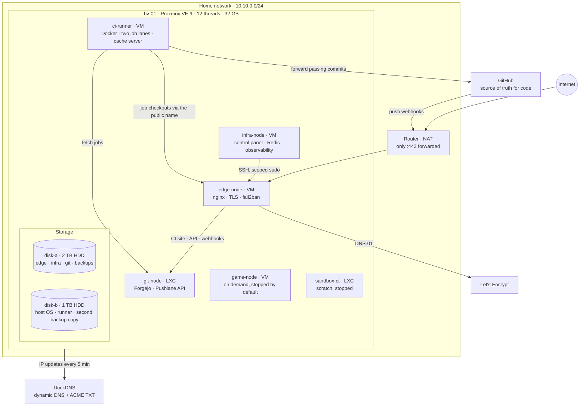

# proxmox-homelab

**The infrastructure map of a one-box homelab.** A single Proxmox VE host runs an internet-facing edge proxy,
a private control plane that deploys web apps, a self-hosted Git server with a CI system in front of GitHub,
a sandboxed CI runner and a couple of on-demand guests. This repository documents how those pieces fit
together: hardware, storage, networking, security layers, backups, day-to-day operations and the edge cases
the setup has already survived.

<p>


</p>

> **About this repository.** It describes a real, running homelab, but every hostname, address, domain,
> account and number in it is a placeholder or an illustrative value. The structure, the mechanisms and the
> failure stories are real. See [Sanitisation](#sanitisation).

The software that runs on top of this infrastructure (the deploy control panel and the Pushlane CI system)
lives in its own repository: **[Homelab-Control-Plane](https://github.com/tobioj/Homelab-Control-Plane)**.

---

## Contents

- [At a glance](#at-a-glance)
- [Topology](#topology)
- [Guest inventory](#guest-inventory)
- [Design principles](#design-principles)
- [Edge cases it already handles](#edge-cases-it-already-handles)
- [Repository map](#repository-map)
- [Sanitisation](#sanitisation)

---

## At a glance

| | |
| --- | --- |
| **Hypervisor** | One Proxmox VE 9 host, `hv-01`: 12 threads, 32 GB RAM, two spinning disks, no SSD |
| **Guests** | 4 KVM virtual machines and 2 LXC containers, each with its own storage pool |
| **Public surface** | One forwarded port (`:443`) on the router, terminated by nginx on `edge-node` |
| **TLS** | Let's Encrypt over DNS-01 (the ISP blocks inbound `:80`), dynamic DNS kept current by a timer |
| **Workloads** | App deployment control plane, Git hosting, CI with two job lanes, observability, an on-demand game server |
| **Security** | Rate limits, a catch-all `444` vhost, five fail2ban jails, phone alerts and a daily digest, 2FA everywhere |
| **CI isolation** | Jobs run in unprivileged containers on a firewalled VM that cannot reach the rest of the LAN |
| **Backups** | Nightly snapshot backups to one disk, a weekly second copy on the other |
| **Operations** | One admin CLI, systemd timers for every recurring job, changes that never kill a running CI job |

---

## Topology



Two rules shape the whole picture:

1. **Only `edge-node` is reachable from the internet**, and only on `:443`. Everything else is LAN-only.
2. **The CI runner is treated as hostile.** It runs other people's code, so its firewall lets it talk to the
   internet, to `git-node` and to the edge proxy, and to nothing else on the LAN.

The network path in detail is in [docs/NETWORK.md](docs/NETWORK.md).

---

## Guest inventory

All sizes are illustrative.

| Guest | Type | vCPU / RAM | Role | Exposure | Backed up |
| --- | --- | --- | --- | --- | --- |
| `edge-node` | VM | 2 / 4 GB (floor 2 GB) | Public nginx, TLS, fail2ban, data plane for deployed apps | `:443` via the router | Nightly + weekly copy |
| `infra-node` | VM | 4 / 8 GB (floor 4 GB) | Deploy control panel, shared Redis, Grafana, Loki, GlitchTip, ntfy | LAN only | Nightly + weekly copy |
| `git-node` | LXC | 2 / 2 GB (hard cap) | Forgejo v15 LTS, the Pushlane API, the GitHub sync service | Through `edge-node` only | Nightly + weekly copy |
| `ci-runner` | VM | 8 / 12 GB fixed + 4 GB zram | Docker CI runner: a priority lane and a shared lane | None (outbound only) | No: rebuilt from scripts |
| `game-node` | VM | 6 / 20 GB | Game server, started on demand | Only while it is running | No: replaceable |
| `sandbox-ct` | LXC | 1 / 1 GB | Scratch container for experiments | LAN only | No |

Per-guest detail: [docs/GUESTS.md](docs/GUESTS.md). Hardware, storage pools and the RAM budget:
[docs/HOST.md](docs/HOST.md).

---

## Design principles

| Principle | What it means here |
| --- | --- |
| **One door in** | A single forwarded port, a single proxy, a single place to rate-limit, log and ban. |
| **Untrusted code gets its own box** | CI jobs run in unprivileged containers on a dedicated VM with an egress firewall. |
| **Nothing important lives only on one disk** | Nightly backups land on one disk, a weekly second copy on the other. |
| **The disposable stays disposable** | The runner is rebuilt from scripts in minutes, so it is deliberately not backed up. |
| **Every recurring job is a timer** | DNS updates, account-to-lane sync, cleanup and backups are all systemd or Proxmox schedules, never a hand-run step. |
| **Changes never kill work in flight** | Reconfiguring a CI lane waits for its running jobs to finish. |
| **Measure the real bottleneck** | On spinning disks, I/O, not CPU, sets how many CI jobs can run at once. |

---

## Edge cases it already handles

Each one is a real failure that changed the design. Full write-ups, as symptom, cause, fix and lesson, are in
[docs/EDGE-CASES.md](docs/EDGE-CASES.md).

| Situation | How it is handled |
| --- | --- |
| Ten concurrent CI jobs saturated the disk and Docker stopped answering | Concurrency cut to 3 + 2 jobs, test databases moved to tmpfs |
| Two runner processes corrupted each other's action cache | Each lane gets its own folder; a test reproduces the old collision |
| Forgejo cannot keep an instance-wide runner away from some accounts | Per-account runner identities, kept in sync by a timer |
| A deleted account made a CI lane refuse to start | Dead identities are filtered out before a lane restarts |
| Reconfiguring a lane used to cancel running jobs | Lanes drain gracefully: no new jobs, running ones finish |
| The onboard network card hung under heavy CI traffic | Segmentation and receive offloads turned off, persisted in the network config |
| The host was powered off mid-job | Filesystems recover, guests start on boot, a checklist verifies the rest |
| The router cannot hairpin NAT | Containers and jobs resolve the public name to the edge proxy's LAN address |
| The ISP blocks inbound `:80` | Certificates use DNS-01 through the dynamic DNS provider |
| A bad webhook secret could get GitHub banned | Signature failures answer `403`, which the ban rules ignore; only `401`s count |
| The heavy game VM and CI cannot share the RAM | The status check warns whenever both would run |

---

## Repository map

```
.
├── README.md            this page
├── docs/
│   ├── HOST.md          hardware, storage pools, RAM budget, why the disk is the limit
│   ├── GUESTS.md        every VM and container: role, resources, exposure, management
│   ├── NETWORK.md       LAN, router, edge routes, DNS, firewall, request flow
│   ├── SECURITY.md      the layers from the internet inward, and the honest weak spots
│   ├── BACKUPS.md       schedule, two-disk copies, retention, restore
│   ├── OPERATIONS.md    runbooks for the things that actually come up
│   └── EDGE-CASES.md    failures, root causes and fixes
└── LICENSE
```

---

## Sanitisation

This repository is meant to show structure and engineering, not to describe my actual network.

| Real value | Here |
| --- | --- |
| Host and guest names | `hv-01`, `edge-node`, `infra-node`, `git-node`, `ci-runner`, `game-node`, `sandbox-ct` |
| Private addresses | `10.10.0.0/24` |
| Public addresses | RFC 5737 documentation ranges (`203.0.113.x`) |
| Domains | `<app>.duckdns.org`, `example-ci.duckdns.org` |
| Accounts | `operator`, `collaborator-a`, `friend-b` |
| Hardware sizes, guest sizes, job limits, lane sizes, schedules, retention, thresholds and incident counts | Illustrative values that keep the real proportions, not the real numbers |

No credential, token, key or certificate appears here in any form.

---

## License

MIT, see [LICENSE](LICENSE).
