# Backups

Two copies, on two disks, on two schedules. Anything that cannot be rebuilt from scripts is backed up;
anything that can is deliberately left out. Times and retention are illustrative.

---

## What is backed up

| Guest | Backed up | Why |
| --- | --- | --- |
| `edge-node` | Yes | TLS certificates, proxy and ban configuration, deployed apps |
| `infra-node` | Yes | The control panel's database (state, encrypted secrets, audit log) and the observability stack |
| `git-node` | Yes | Every repository, account, CI history and the GitHub App's state |
| `ci-runner` | **No** | Disposable: provisioning scripts rebuild it from nothing in minutes |
| `game-node` | **No** | Large and replaceable |
| `sandbox-ct` | **No** | Scratch space by definition |

Leaving the runner out is a design choice, not an omission: everything on it is either downloaded (images,
caches) or regenerated (lane configs from the account list, runner identities reused from the host).

---

## Schedule

```mermaid
gantt
    dateFormat HH:mm
    axisFormat %H:%M
    title A typical week
    section Nightly (disk-a)
    Snapshot backup of edge infra and git :03:15, 40m
    section Sunday only (disk-b)
    Second copy on the other disk      :05:00, 40m
```



| Job | When | Where | Keeps |
| --- | --- | --- | --- |
| Nightly | 03:15 every day | Backup directory on `disk-a` | 7 daily, 4 weekly, 2 monthly |
| Weekly second copy | Sunday 05:00 | `disk-b` | The last 2 |

Both jobs use **snapshot mode** (guests keep running), compress with `zstd`, and send a notification only on
failure. They run in the quietest hours, after the day's CI has finished and before it starts.

### Why two disks

The host has two spinning disks and no RAID. With backups on only one of them, losing that disk would take the
guests *and* their backups at once. Splitting them means:

- `disk-a` dies: the guests on it are gone, but the weekly copy on `disk-b` survives.
- `disk-b` dies: the host OS and the runner are gone (both rebuildable), and the nightly backups on `disk-a`
  survive.

The cost is that the second copy is up to a week old. For this workload that is the right trade: the Git
server's real source of truth for code is GitHub anyway.

---

## Protected backups

A handful of older manual backups, taken before major changes, are marked **protected**, so automatic pruning
never removes them. They are the "known good before I changed everything" baseline.

---

## Restoring

A container (the Git server) and a VM restore the same way: pick the archive, choose the target storage,
overwrite.

```bash
# list what exists
ls /path/to/backups/dump/

# restore the Git server container over itself
pct restore <git-node-id> /path/to/backups/dump/vzdump-lxc-<id>-<date>.tar.zst --storage git-pool --force

# restore a VM
qmrestore /path/to/backups/dump/vzdump-qemu-<id>-<date>.vma.zst <vm-id> --storage infra-pool --force
```

After a restore of `git-node`, the lane sync timer reconciles the CI lanes with the restored account list
within two minutes, registering any runner identity the older database no longer knows. After a restore of `edge-node`, certificates come back with it; if one has expired meanwhile, the
renewal timer reissues it.

### The runner, instead of a restore

```bash
ci-admin rebuild-runner      # destroy and rebuild the CI VM from the provisioning scripts
```

It reinstalls Docker, the runner, the cache server and both lanes, reuses the runner identities stored on the
host, and pre-pulls the common job images.

---

## Integrity after an unclean shutdown

Snapshot backups are only as good as what they capture. After a hard power-off, the checklist in
[OPERATIONS.md](OPERATIONS.md#after-an-unclean-power-off) runs before trusting the next backup: filesystem
journal recovery, SMART health on both disks, and a `quick_check` of the Git server's SQLite database.
