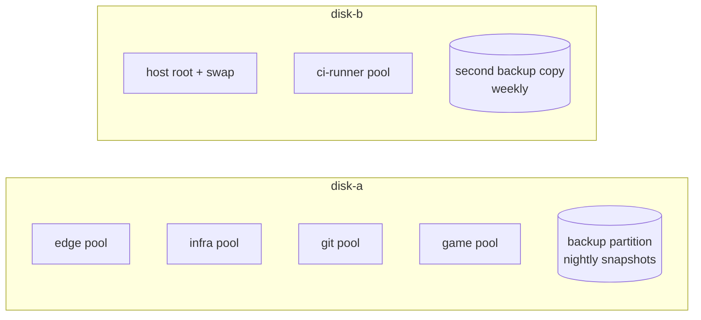

# The host: `hv-01`

One Proxmox VE 9 machine carries everything. This page covers what it is made of in broad strokes, how its
storage is carved up, how memory is shared out, and why the disks, not the CPU, decide how much CI can run at
once. Exact hardware and guest sizes are deliberately not published; the proportions and the policies are what
matter.

---

## Contents

- [Hardware](#hardware)
- [Storage layout](#storage-layout)
- [Memory policy](#memory-policy)
- [Why the disk is the real limit](#why-the-disk-is-the-real-limit)
- [Network card tuning](#network-card-tuning)
- [Host-level timers](#host-level-timers)

---

## Hardware

| Part | What it is | What it means in practice |
| --- | --- | --- |
| CPU | A desktop-class multi-core processor | Rarely the bottleneck. CI jobs are capped per job, not by the host. |
| Memory | Fixed, with no room to add more | Fully committed. Every guest has a fixed size, a balloon floor or a hard cap. |
| `disk-a` | The larger spinning disk | The edge, the control plane, the Git server, the game server and the nightly backups. |
| `disk-b` | The smaller spinning disk | The host OS, host swap, the CI runner and the weekly second backup copy. |
| Network | One onboard gigabit port, bridged as `vmbr0` | Every guest shares it. Its offloads are tuned (see [below](#network-card-tuning)). |

There is no SSD. That single fact explains most of the tuning on this page, and it is why the CI system can
also borrow a workstation (see [GUESTS.md](GUESTS.md#ws-runner)).

---

## Storage layout

Each guest gets its **own thin pool**, so one guest filling its disk cannot starve another, and a pool can be
grown or moved without touching its neighbours.

| Decision | Why |
| --- | --- |
| A thin pool per guest | Quotas by construction; a runaway log or Docker layer cache stays inside its own guest. |
| The runner on the other disk from the Git server | CI is the noisiest I/O on the box. Keeping it off `disk-a` keeps Git, the edge and the control plane responsive while jobs run. |
| Backups on both disks | A nightly copy on `disk-a`, a weekly copy on `disk-b`: either disk can die and a recent backup survives on the other. See [BACKUPS.md](BACKUPS.md). |
| The nightly backups on a partition of their own | Backups can fill their space without ever filling a guest's pool. |
| The Git server's database is SQLite | One writer, one file, trivially backed up with the container. At this scale a database server would be one more thing to supervise. |

---

## Memory policy

Memory can't be upgraded, so every guest has an explicit policy rather than a hopeful size.

| Guest | Policy | Why |
| --- | --- | --- |
| `edge-node` | Ballooned, with a floor | It uses far less than its allocation; its file cache is handed back when the host is short. |
| `infra-node` | Ballooned, with a floor | The same: its page cache is the first thing to shrink. |
| `git-node` | A hard cap (a container) | Capped by cgroups; it cannot grow past it. |
| `ci-runner` | **Fixed**, plus compressed swap (zram) inside | Fixed on purpose: a burst of CI jobs can never take memory from the other guests. |
| `game-node` | Large, and only when CI is stopped | It does not fit next to the CI runner. |
| Host | A small reserve | Proxmox itself, LVM metadata and the backup jobs. |

Two details worth calling out:

- **zram, not disk swap, inside the runner.** Swapping to a spinning disk that CI is already saturating
  makes everything worse at once. Compressed swap in RAM gives overlapping jobs a cushion without touching
  the disk.
- **The heavy VM is guarded by the status check.** `ci-admin status` prints a warning whenever `game-node`
  is running, because it and the runner together exceed the host's memory. The rule is simple: stop the
  runner first, or don't start the game server.

---

## Why the disk is the real limit

On paper the CPU and memory could carry more concurrent CI jobs. In practice the first thing to give out is
the disk:

- Every job pulls or unpacks container images, installs dependencies and writes build output.
- Jobs with database services (`services: postgres`) add a database writing to the same spindle.
- A spinning disk handles a handful of concurrent random writers well and many of them very badly.

When a burst of jobs with database services ran at once, I/O pressure inside the runner passed half, Docker
answered so slowly that service health checks and the runner's own calls timed out, and jobs failed for reasons
that had nothing to do with their code. The fix was to measure rather than guess: concurrency came down in
steps, a measurement tool now records each job's real memory and CPU use so slot counts are set from data, and
test databases keep their data on `tmpfs`, so they start in seconds and never touch the disk. The full story is
in [EDGE-CASES.md](EDGE-CASES.md#1-concurrent-ci-jobs-saturating-a-spinning-disk).

Two levers remain. The one already in use is the **workstation lane**: a CI VM on a desktop with its own
solid-state disk, which ran the same test suite two to three times faster than the host. The other is hardware:
an SSD for the runner's pool would lift the host's own ceiling more than any tuning can.

---

## Network card tuning

The onboard Intel NIC (e1000e driver) is known to lock up its transmit queue under heavy traffic with
segmentation offload on. It did, once: the host kept running but it and every guest dropped off the network.
TCP segmentation, generic segmentation and generic receive offload are now off, applied live and persisted as
a `post-up` line on the interface. At gigabit speeds the extra CPU cost is negligible.
See [EDGE-CASES.md](EDGE-CASES.md#6-the-onboard-network-card-hanging-under-load).

---

## Host-level timers

| Timer | Interval | Job |
| --- | --- | --- |
| Dynamic DNS | Every few minutes | Points the public names at the current WAN address; alerts on change. |
| Lane sync | Every minute | Keeps every CI lane's list of accounts in step with the Git server, and switches the priority lanes when the workstation comes or goes. |
| Backups | Nightly and weekly | Proxmox snapshot backups to both disks. |
