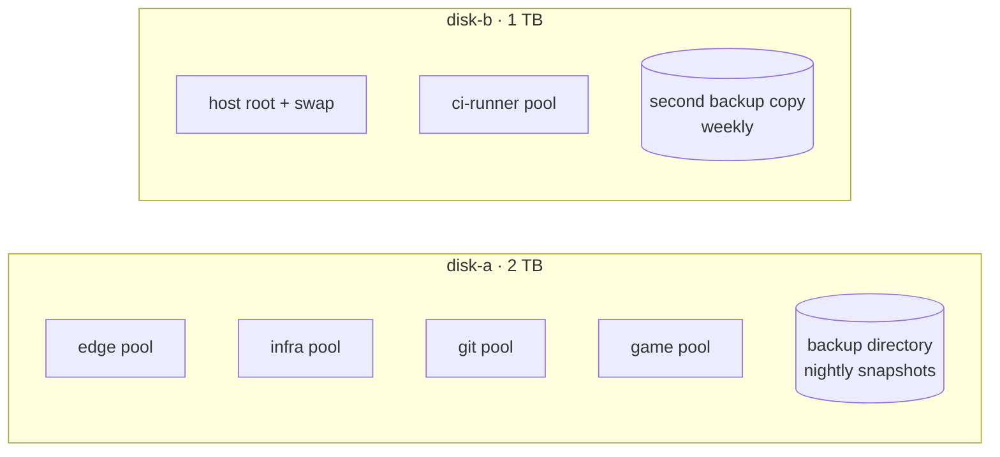

# The host: `hv-01`

One Proxmox VE 9 machine carries everything. This page covers what it is made of, how its storage is carved
up, how the RAM is budgeted, and why the disks, not the CPU, decide how much CI can run at once.

All sizes are illustrative; the proportions are real.

---

## Hardware

| Part | What it is | What it means in practice |
| --- | --- | --- |
| CPU | 12 threads | Rarely the bottleneck. CI jobs are capped per job, not by the host. |
| RAM | 32 GB, no room to add more | Fully committed. Every guest has a fixed size or a balloon floor. |
| `disk-a` | 2 TB spinning disk | Edge, control plane, Git server and the nightly backups. |
| `disk-b` | 1 TB spinning disk | Host OS, host swap, the CI runner and the weekly second backup copy. |
| Network | One onboard 1 GbE port, bridged as `vmbr0` | Every guest shares it. Its offloads are tuned (see below). |

There is no SSD. That single fact explains most of the tuning on this page.

---

## Storage layout

Each guest gets its **own thin pool**, so one guest filling its disk cannot starve another, and a pool can be
grown or moved without touching its neighbours.

| Decision | Why |
| --- | --- |
| A thin pool per guest | Quotas by construction; a runaway log or Docker layer cache stays inside its own guest. |
| The runner on the other disk from the Git server | CI is the noisiest I/O on the box. Keeping it off `disk-a` keeps Git, the edge and the control plane responsive while jobs run. |
| Backups on both disks | A nightly copy on `disk-a`, a weekly copy on `disk-b`: either disk can die and a recent backup survives on the other. See [BACKUPS.md](BACKUPS.md). |
| The Git server's database is SQLite | One writer, one file, trivially backed up with the container. At this scale a database server would be one more thing to supervise. |

---

## RAM budget

RAM cannot be upgraded, so the budget is explicit.

| Guest | Allocation (illustrative) | Policy |
| --- | --- | --- |
| `edge-node` | 4 GB, balloon floor 2 GB | Gives page cache back to the host when the host is short. |
| `infra-node` | 8 GB, balloon floor 4 GB | Same: its file cache is the first thing to shrink. |
| `git-node` | 2 GB hard cap | A container: capped by cgroups, cannot balloon past it. |
| `ci-runner` | 12 GB **fixed**, plus 4 GB zram inside | Fixed on purpose: a burst of CI jobs can never take memory from the other guests. |
| `game-node` | 20 GB | Does not fit next to the CI runner. Started only when CI can be paused. |
| Host | about 3 GB | Proxmox itself, LVM metadata, the backup jobs. |

Two details worth calling out:

- **zram, not disk swap, inside the runner.** Swapping to a spinning disk that CI is already saturating
  makes everything worse at once. Compressed swap in RAM gives overlapping jobs a cushion without touching
  the disk.
- **The heavy VM is guarded by the status check.** `ci-admin status` prints a warning whenever `game-node`
  is running, because it and the runner together exceed the host's RAM. The rule is simple: stop the
  runner first, or don't start the game server.

---

## Why the disk is the real limit

On paper the CPU and RAM could carry more concurrent CI jobs. In practice the first thing to give out is the
disk:

- Every job pulls or unpacks container images, installs dependencies and writes build output.
- Jobs with database services (`services: postgres`) add a database writing to the same spindle.
- A spinning disk handles a handful of concurrent random writers well and many of them very badly.

When ten jobs ran at once, I/O pressure inside the runner reached about 70%, Docker answered so slowly that
service health checks and the runner's own calls timed out, and jobs failed for reasons that had nothing to
do with their code. The fix was to measure rather than guess: concurrency came down step by step (5 + 5,
then 3 + 3, now 3 + 2), and test databases now keep their data on `tmpfs`, so they start in seconds and
never touch the disk. The full story is in [EDGE-CASES.md](EDGE-CASES.md#1-concurrent-ci-jobs-saturating-a-spinning-disk).

The biggest remaining lever is hardware: an SSD for the runner's pool would lift that ceiling more than any
tuning can.

---

## Network card tuning

The onboard Intel NIC (e1000e driver) is known to lock up its transmit queue under heavy traffic with
segmentation offload on. It did, once: the host kept running but it and every guest dropped off the network.
TCP segmentation, generic segmentation and generic receive offload are now off, applied live and persisted as
a `post-up` line on the interface. At 1 GbE the extra CPU cost is negligible.
See [EDGE-CASES.md](EDGE-CASES.md#6-the-onboard-network-card-hanging-under-load).

---

## Host-level timers

| Timer | Interval | Job |
| --- | --- | --- |
| Dynamic DNS | every 5 minutes | Points the public names at the current WAN address; alerts on change. |
| Lane sync | every 2 minutes | Keeps the CI lanes' list of accounts in step with the Git server. |
| Backups | nightly and weekly | Proxmox snapshot backups to both disks. |
