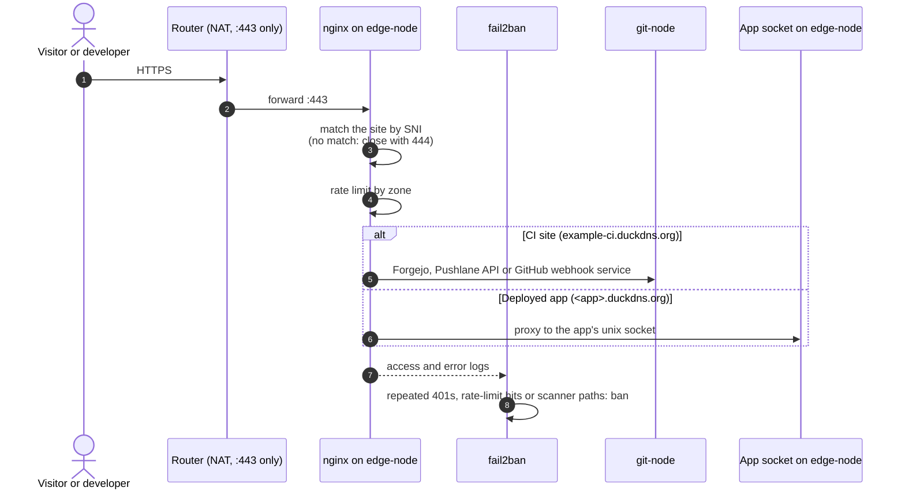

# Network

How traffic gets in, where it goes, and what each guest is allowed to talk to. Addresses are placeholders.

---

## Layout

| Address | Who |
| --- | --- |
| `10.10.0.1` | Router: NAT, one dynamic WAN address, forwards only `:443` |
| `10.10.0.2` | `hv-01` (Proxmox management, LAN only) |
| `10.10.0.10` | `edge-node` |
| `10.10.0.11` | `infra-node` |
| `10.10.0.30` | `git-node` |
| `10.10.0.40` | `ci-runner` |
| `10.10.0.50` | `game-node` |
| `10.10.0.60` | `sandbox-ct` |

One flat `/24`. Every guest sits on the host's single bridge, `vmbr0`, which is attached to the onboard NIC.
Guests are addressed by IP, never by hostname.

---

## The way in

The router forwards exactly one port, `:443`, to `edge-node`. Nothing else is reachable from the internet:
not the hypervisor, not the control panel, not the Git server directly, not the runner.

### Routes on the CI site

| Path | Goes to | Notes |
| --- | --- | --- |
| `/` | Forgejo on `git-node` | Web UI, Git over HTTPS, the REST API |
| sign-in, 2FA and token pages | Forgejo | Their own, much stricter rate limit (12 per minute) |
| `/pushlane-api/` | The Pushlane API on `git-node` | Job logs, re-run, cancel; every call checked by Forgejo with the caller's own token |
| `/pushlane-api/v1/github/` | The GitHub sync service on `git-node` | Webhooks, verified by signature; larger body limit |
| `/agents.md`, `/llms.txt`, `/get-started` | Static docs served by Forgejo | Guides for people and their AI agents |

### The catch-all

The first site nginx loads is a `default_server` that answers any unknown `Host` with `444` (close the
connection, send nothing). Without it, a request for a name nginx does not know would be answered by
whichever site happens to sort first: one app answering for a domain that is not its own.

---

## Names and certificates

- **Dynamic DNS.** A timer on the host pushes the current WAN address to DuckDNS every 5 minutes and sends a
  phone alert when it changes. The list of names it maintains comes from the system's own state, never from a
  hand-typed list.
- **DNS-01, because port 80 is blocked.** The ISP drops inbound `:80`, so HTTP-01 validation is impossible.
  Certificates are issued by publishing the challenge as a TXT record through the DNS provider's API, waiting
  until two independent public resolvers both see it, then letting validation proceed.
- **Renewal** runs on a timer and needs no human, because it only ever renews names a human approved once.

---

## Hairpin NAT, worked around

The router cannot send traffic for its own public address back into the LAN. That matters because CI jobs
check code out from the CI site by its **public** name.

| Who | Workaround |
| --- | --- |
| CI job containers | Started with `--add-host example-ci.duckdns.org:10.10.0.10`, so the public name resolves straight to the edge proxy |
| Admin scripts on the host | `curl --resolve` and Git's `http.curloptResolve` pin the public name to the edge proxy |

The certificate still matches, because the name is unchanged; only the address it resolves to differs.

---

## What each guest may reach

| From | May reach | Enforced by |
| --- | --- | --- |
| Internet | `edge-node:443` | The router's single forward |
| `edge-node` | `git-node` (web, API, webhook service), app sockets | Network position |
| `infra-node` | `edge-node` over SSH | One key, a scoped `sudo` allowlist on the far side |
| `ci-runner` | The internet; `git-node` (job fetches); `edge-node:443` (checkouts) | Its Proxmox firewall: everything else private is dropped |
| `hv-01` | Every guest (administration) | The admin CLI; SSH to the runner is the runner's only inbound rule |

### The runner's firewall

The runner executes code written by other people, so it is the one guest with a strict firewall:

- **Inbound:** dropped, except SSH from the host.
- **Outbound:** allowed to the internet (registries, GitHub, Docker Hub), to the Git server's runner port and
  to the edge proxy's `:443`. Every other private range (all of RFC 1918), link-local, carrier-grade NAT,
  multicast and the IPv6 private and link-local ranges are dropped.
- **Anti-spoofing:** an IP filter pins the runner to its own address.

A compromised job can therefore reach the internet, as any CI job can, but not the control plane, the router,
the hypervisor or anyone's laptop.

---

## The physical link

Every guest shares one onboard gigabit NIC. Its segmentation and receive offloads are off, because the driver
locked up under heavy CI traffic once and took the whole box offline. If it ever hangs again, bouncing the
link from the console brings the network back without a reboot. See
[EDGE-CASES.md](EDGE-CASES.md#6-the-onboard-network-card-hanging-under-load).
