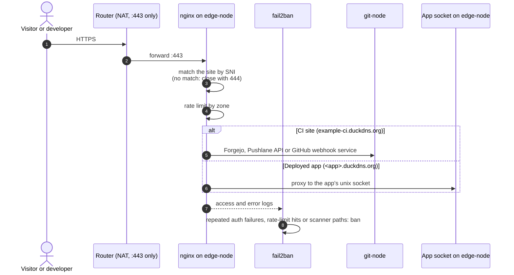
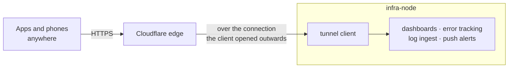

# Network

How traffic gets in, how the one exception gets out, where everything goes, and what each guest is allowed to
talk to. Addresses are placeholders.

---

## Contents

- [Layout](#layout)
- [The way in](#the-way-in)
- [The second way in: an outbound tunnel](#the-second-way-in-an-outbound-tunnel)
- [Names and certificates](#names-and-certificates)
- [Hairpin NAT, worked around](#hairpin-nat-worked-around)
- [What each machine may reach](#what-each-machine-may-reach)
- [The physical link](#the-physical-link)

---

## Layout

One flat private `/24` (shown here as `10.10.0.0/24`) behind a consumer router with one dynamic WAN address.

| Who | How it is addressed |
| --- | --- |
| Router | The gateway: NAT, one dynamic WAN address, a single port forward |
| `hv-01` | A static address for Proxmox management, reachable from the LAN only |
| Guests on `hv-01` | Static addresses, all on the host's single bridge, `vmbr0`, attached to the onboard NIC |
| `ws-runner` | An address from the router's DHCP; the host finds it by its network card's MAC address |

Guests are addressed by IP, never by hostname: one guest's hostname once matched the hypervisor's, a harmless
typo that would have made name-based addressing ambiguous.

---

## The way in

The router forwards exactly one port, `:443`, to `edge-node`. Nothing else is forwarded: not the hypervisor,
not the control panel, not the Git server directly, not the runners.

### Routes on the CI site

| Path | Goes to | Notes |
| --- | --- | --- |
| `/` | Forgejo on `git-node` | Web UI, Git over HTTPS, the REST API |
| Sign-in, 2FA and token pages | Forgejo | Their own, much stricter rate limit |
| `/pushlane-api/` | The Pushlane API on `git-node` | Job logs, run results with reasons, re-run, cancel, setup progress; every call checked by Forgejo with the caller's own token |
| `/pushlane-api/v1/github/` | The GitHub sync service on `git-node` | Webhooks, verified by signature; a larger body limit |
| A run's cancel button | Forgejo, and a mirrored copy to an internal path | nginx mirrors the request, without its body, so the results service can record who cancelled; outsiders get `404` on the internal path |
| `/agents.md`, `/llms.txt`, `/get-started` | Static docs served by Forgejo | Guides for people and their AI agents |

### The catch-all

The first site nginx loads is a `default_server` that answers any unknown `Host` with `444` (close the
connection, send nothing). Without it, a request for a name nginx does not know would be answered by
whichever site happens to sort first: one app answering for a domain that is not its own.

---

## The second way in: an outbound tunnel

The observability services on `infra-node` have to be reachable from outside: apps send errors and logs from
wherever they run, and push alerts have to reach a phone away from home. Instead of a second port forward, they
are published through a **Cloudflare Tunnel**.

| Property | What it means |
| --- | --- |
| Outbound-only | The tunnel client dials out from `infra-node`. The router opens no port, and nothing about the `:443` path changes. |
| An explicit list | The tunnel's configuration names each published service; any other name gets `404`. The control panel, Redis and the hypervisor are not on the list. |
| Authentication stays with the service | Dashboards and the error tracker require a sign-in, log ingest sits behind an authenticating proxy, error ingest needs a per-project key, alert topics are private. |
| Separate from the edge | The edge proxy's rate limits and bans don't apply here, and a problem at the edge can't take the observability path down with it. |

---

## Names and certificates

- **Dynamic DNS.** A timer on the host pushes the current WAN address to DuckDNS every few minutes and sends a
  phone alert when it changes. The list of names it maintains comes from the system's own state, never from a
  hand-typed list.
- **DNS-01, because port 80 is blocked.** The ISP drops inbound `:80`, so HTTP-01 validation is impossible.
  Certificates are issued by publishing the challenge as a TXT record through the DNS provider's API, waiting
  until two independent public resolvers both see it, then letting validation proceed.
- **Renewal** runs on a timer and needs no human, because it only ever renews names a human approved once.

---

## Hairpin NAT, worked around

The router cannot send traffic for its own public address back into the LAN. That matters because CI jobs
check code out from the CI site by its **public** name.

| Who | Workaround |
| --- | --- |
| CI job containers | Started with `--add-host example-ci.duckdns.org:<edge-node address>`, so the public name resolves straight to the edge proxy |
| Admin scripts on the host | `curl --resolve` and Git's `http.curloptResolve` pin the public name to the edge proxy |

The certificate still matches, because the name is unchanged; only the address it resolves to differs.

---

## What each machine may reach

| From | May reach | Enforced by |
| --- | --- | --- |
| Internet, via the router | `edge-node:443` | The router's single forward |
| Internet, via the tunnel | The listed observability services on `infra-node` | The tunnel's own service list, then each service's authentication |
| `edge-node` | `git-node` (web, API, webhook service), app sockets | Network position |
| `infra-node` | `edge-node` over SSH; the tunnel provider, outbound | One key, a scoped `sudo` allowlist on the far side |
| `ci-runner` | The internet; `git-node` (job fetches); `edge-node:443` (checkouts) | Its Proxmox firewall: everything else private is dropped |
| `ws-runner` | The same three destinations | A guard inside the VM, loaded before Docker |
| `hv-01` | Every guest, and `ws-runner` over SSH (administration) | The admin CLI |

The Proxmox firewall is enabled at the datacentre level with a permissive default, and only the runner has rules
of its own: it is the one guest that runs code written by other people.

### The runner's firewall

- **Inbound:** dropped, except SSH from the host.
- **Outbound:** allowed to the internet (registries, GitHub, Docker Hub), to the Git server's runner port and
  to the edge proxy's `:443`. Every other private range (all of RFC 1918), link-local, carrier-grade NAT,
  multicast and the IPv6 private and link-local ranges are dropped.
- **Anti-spoofing:** IP and MAC filters pin the runner to its own address.

A compromised job can therefore reach the internet, as any CI job can, but not the control plane, the router,
the hypervisor or anyone's laptop.

### The workstation's guard

The workstation lane's VM is bridged onto the home network, and a desktop operating system's firewall can't
filter bridged VM traffic. So the same allow list is enforced from inside the VM by nftables:

- The guard loads before Docker on every boot, and Docker is configured not to start without it.
- Only the host may open SSH to it, and SSH replies to the host are always allowed out, so loading or reloading
  the guard can never cut off the session doing it.
- Jobs reach the internet, `git-node` and the edge proxy, and nothing else on the LAN, including the
  workstation itself.

---

## The physical link

Every guest shares one onboard gigabit NIC. Its segmentation and receive offloads are off, because the driver
locked up under heavy CI traffic once and took the whole box offline. If it ever hangs again, bouncing the
link from the console brings the network back without a reboot. See
[EDGE-CASES.md](EDGE-CASES.md#6-the-onboard-network-card-hanging-under-load).
