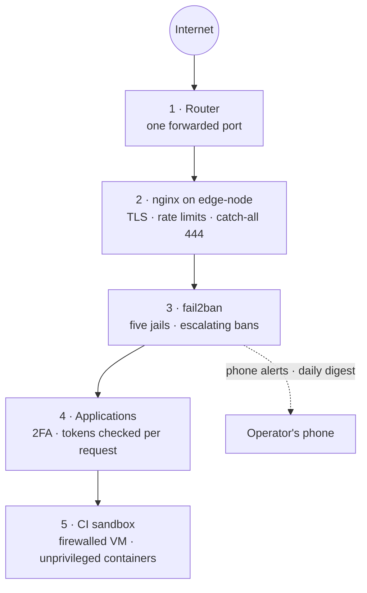

# Security

A homelab that serves public traffic and runs other people's CI jobs. The model is layered from the internet
inward; each layer assumes the one outside it can fail. Thresholds and limits are illustrative.

---

## The layers

---

## 1. Router

Only `:443` is forwarded, and only to `edge-node`. The hypervisor's management UI, SSH on every guest, the
control panel, Redis and the observability stack are all LAN-only.

## 2. The edge proxy

| Control | Detail |
| --- | --- |
| TLS everywhere | Let's Encrypt certificates over DNS-01; no plain-HTTP listener is exposed |
| Catch-all `444` | Unknown `Host` names get a closed connection, never another site's content |
| Rate limits per zone | Sign-in, 2FA and token pages: 12 requests a minute. The API: 6 a second. Everything else: 40 a second. Over the limit is `429` |
| One upstream per route | The Git web UI, the Pushlane API and the webhook service each have their own location and limits |

## 3. fail2ban

Five jails read the proxy's and SSH's logs. Bans grow on repeat (`bantime.increment`). Bans for failed
sign-ins, rate-limit abuse and repeat offenders send a phone notification at once; scanner bans only appear in
the digest, because they are constant background noise.

| Jail | Trigger (illustrative) | Ban |
| --- | --- | --- |
| Failed sign-ins | 6 `401`s on the CI site or its API within 10 minutes | Hours, growing on repeat |
| Rate-limit abuse | Repeated `limit_req` rejections on the sign-in pages | Hours, growing on repeat |
| Scanners | Probes for `wp-login.php`, `.env`, `.git/config`, `phpmyadmin` and friends, or bare-IP requests | A day, growing on repeat |
| Repeat offenders | Banned 3 times in a day by any jail | 7 days, on **all** ports |
| SSH | Failed SSH logins | Standard |

The LAN is never banned. A **daily digest** summarises the last 24 hours: bans per jail, failed sign-ins and
rate-limit hits on the CI site, server errors, the addresses currently blocked and how long the certificates
have left. It is sent as high priority when the day was unusually busy. `ci-admin blocked`,
`block` and `unblock` manage the lists by hand.

### Webhooks answer 403, not 401

GitHub delivers webhooks from a shared pool of addresses. If a webhook secret were ever wrong, every delivery
would fail signature verification; answering those with `401` would let the sign-in jail ban GitHub itself.
The webhook service therefore answers a bad or missing signature with `403`, which no jail counts.

## 4. Applications

| Control | Detail |
| --- | --- |
| 2FA for every account | Service accounts too; enrolled by script, secrets kept root-only on the host |
| Private by default | Repositories are private; storage quotas per plan |
| Tokens checked by the owner | The Pushlane API never decides access itself: every request is replayed against Forgejo with the caller's own token, scopes included |
| Destructive actions previewed | The control panel renders every privileged command and runs it only on confirmation |
| Secrets at rest | Encrypted in the control panel's database; Actions secrets are write-only in Forgejo |

## 5. The CI sandbox

CI jobs are untrusted code. They run under several independent restrictions:

| Restriction | What it stops |
| --- | --- |
| A dedicated VM with an egress firewall | Reaching the control plane, the router, the hypervisor or anything else on the LAN |
| Unprivileged containers | Container escapes through privileged mode |
| Docker user-namespace remapping | Root in a container is not root on the VM |
| No Docker socket, no host bind mounts | Jobs cannot drive Docker or read the VM's files |
| Per-job CPU, memory and process limits | One job starving the others, fork bombs |
| A 60-minute job timeout | Runaway jobs holding a slot forever |
| A localhost-only cache server with per-repository isolation | One project reading another's cached build output |
| A fixed-size VM | A burst of jobs taking memory from the other guests |

---

## Secrets handling

| Secret | Where it lives | How it is protected |
| --- | --- | --- |
| Admin and service-account credentials, 2FA seeds | The host, root-only | Never copied into guests except as a root:service `0640` env file |
| Runner registration tokens | The host and each lane's config | `0600`, owned by the runner user |
| GitHub App private key and webhook secret | The Git server's service state directory | Created by GitHub's manifest flow straight into that directory; never printed |
| Deploy keys for forwarding to GitHub | Forgejo Actions secrets | Write-only; masked in job logs |
| DNS provider token | Only during certificate issuance | Written into a hook script, deleted right after the run |

Nothing sensitive is ever passed on a command line where another process could read it: Git credentials, for
example, travel as `extraHeader` configuration in the environment.

---

## Honest weak spots

Ranked by how much they would matter if the threat model changed.

1. **The LAN is flat.** Household devices share a network with the control plane and its Redis, which has no
   password and relies on network position. VLAN segmentation is the most valuable hardening step not yet
   taken.
2. **One box, one disk controller, one NIC, one WAN address.** Every failure is total. Backups make it
   recoverable, not available.
3. **The runner can reach the whole internet.** CI needs registries and GitHub, so egress is open beyond the
   LAN block. A compromised job could exfiltrate its own repository's data, as on any hosted CI.
4. **Rate limits are per address.** A distributed brute-force attempt would be slowed by 2FA, not by bans.
5. **Third parties.** The DNS provider can redirect traffic; GitHub holds the source of truth.
